

<h3 align="center">From useful ideas to working software.</h3>

AI agents &amp; automation &middot; Web interfaces &middot; Mobile applications

<a href="#about">About</a> &middot; <a href="#focus">Focus</a> &middot; <a href="#experience">Experience</a> &middot; <a href="#projects">Projects</a> &middot; <a href="#stack">Stack</a>

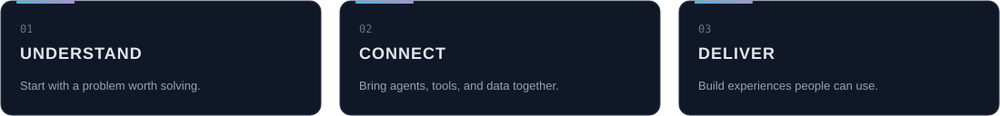

<h2>01 / About</h2>

I'm <strong>Yazan Nazzal</strong>, a software engineer focused on AI agentic engineering, with a background in frontend, mobile, and full-stack development.

I build LLM-powered agents that plan, use tools, and connect to existing systems. My work also spans digital learning platforms and mobile MVPs, with an emphasis on maintainable code, practical evaluation, and clear user experiences.

<h2>02 / What I build</h2>
<h3>AI agents &amp; automation</h3>
Multi-agent workflows, custom MCP integrations, and retrieval pipelines with evaluation and guardrails.

<code>Claude</code> <code>OpenAI</code> <code>LangGraph</code> <code>MCP</code>

<h3>Web &amp; mobile experiences</h3>
Responsive interfaces and mobile applications, connected to APIs and backend services.

<code>React</code> <code>React Native</code> <code>Flutter</code> <code>.NET Core</code>

<h2>03 / Experience</h2><h3>AI Agentic Engineer · Freelance</h3>
Aug 2025 — Present

Agent workflows, MCP integrations, retrieval, and evaluation.

<h3>Front-End Developer · eMicrolearn (Subsidiary of Pitman)</h3>
Dec 2022 — Jul 2025

The iBook digital learning platform: responsive interfaces and product features.

<h3>React Developer · HexaSol</h3>
Nov 2022 — Apr 2023

React applications, Hakini mobile development, and the AZEZA MVP.

<h3>Full-Stack Developer Trainee · IConnect Tech</h3>
Aug 2022 — Oct 2022

Angular and .NET Core training, API development, and database design.

<h2>04 / Projects</h2>

<a href="https://github.com/YazanNazzal/Lumma">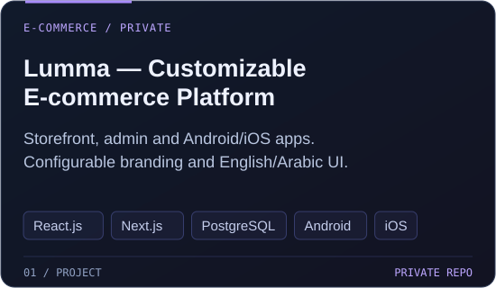</a>

<a href="https://github.com/YazanNazzal/Warraq-PDF-Assistant">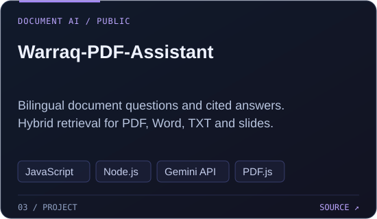</a>

<a href="https://github.com/YazanNazzal/yazan-portfolio">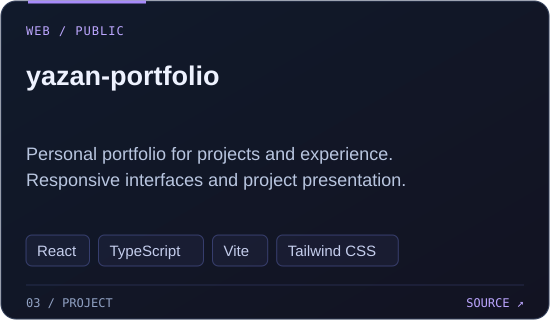</a>

<a href="https://github.com/YazanNazzal/apartment_reservation_app">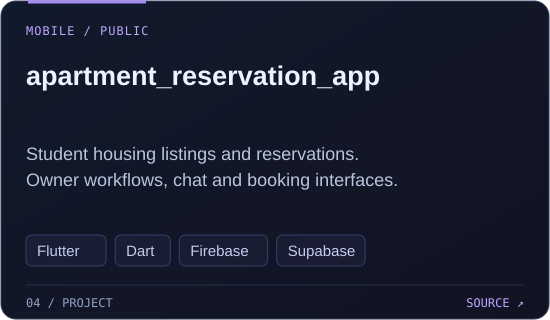</a>

<a href="https://github.com/YazanNazzal/math-tutor-website">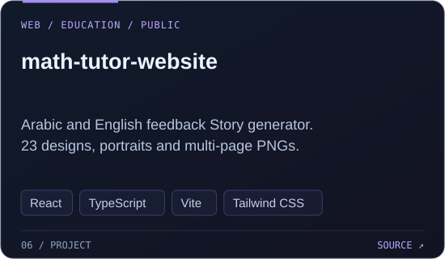</a>

<a href="https://github.com/YazanNazzal/EmployeesAPI-main">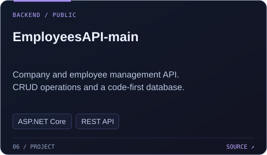</a>

<a href="https://github.com/YazanNazzal/HakiniScreen">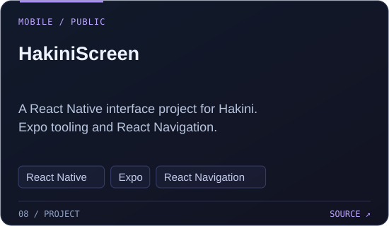</a>

<a href="https://github.com/YazanNazzal/first-app-main">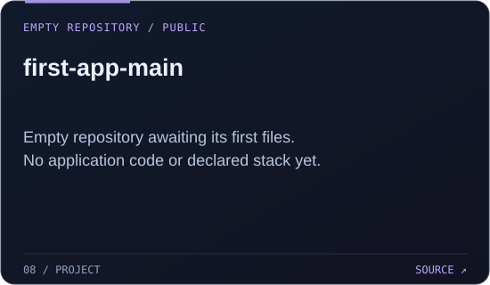</a>

<a href="https://github.com/YazanNazzal/king-of-shisha">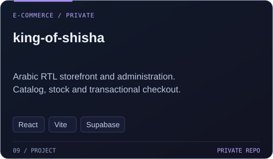</a>

<a href="https://github.com/YazanNazzal/blossom-dreams">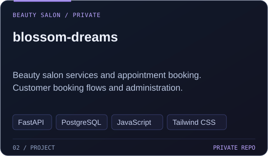</a>

<h2>05 / Toolkit</h2><h3>AI coding tools</h3>
<code>Codex</code> <code>Claude Code</code> <code>Cursor</code> <code>GitHub Copilot</code>

<h3>Agent engineering</h3>
<code>Claude API</code> <code>OpenAI API</code> <code>LangGraph</code> <code>LangChain</code> <code>MCP</code> <code>RAG</code> <code>Python</code>

<h3>Web &amp; mobile</h3>
<code>React</code> <code>TypeScript</code> <code>JavaScript</code> <code>Angular</code> <code>React Native</code> <code>Flutter</code>

<h3>Backend &amp; data</h3>
<code>C#</code> <code>.NET Core</code> <code>SQL Server</code> <code>MongoDB</code> <code>Firebase</code> <code>REST APIs</code>

More about me

Bachelor of Computer System Engineering &mdash; Arab American University.

Arabic: Native &middot; English: Professional working.

Open to project collaborations and engineering opportunities. <a href="https://www.linkedin.com/in/yazan-nazzal-dev/">Let's connect on LinkedIn &#8599;</a>

